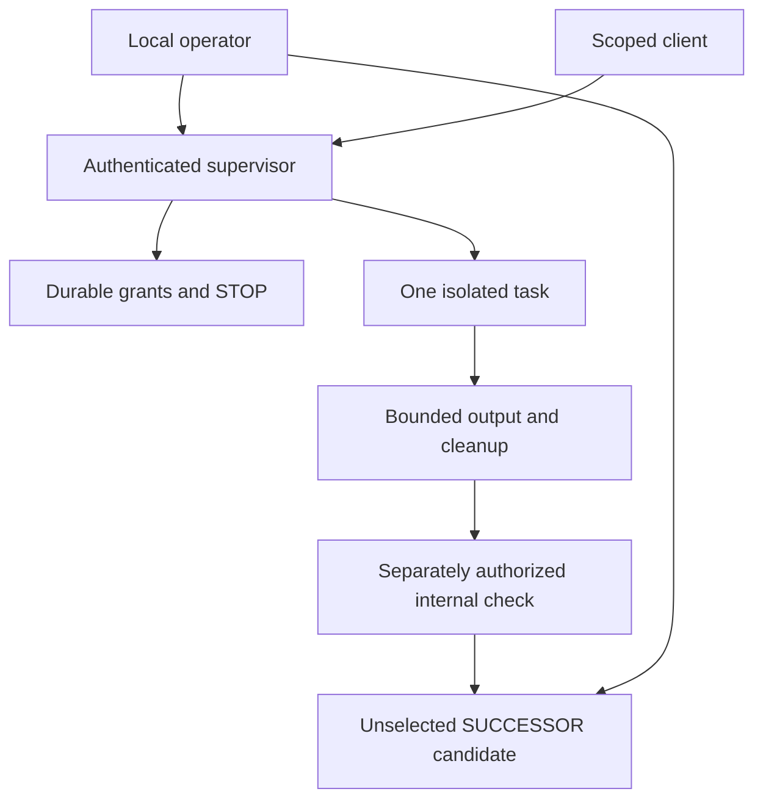

# Local Skills architecture and threat model

## Baseline and dependency

Inspection on 2026-10-13 found main at `22eba990dbaa0083c7c6f21a0638bf546d0d47ed` and active SUCCESSOR PR #25 at `e84ff1c3d5ce129f2c953a3216dfa36338c7a905`. That was the original stacked baseline; its observations remain historical. PR #25 has since merged at `e120d55fb0b0d1f97691c59c5923ec400df14d14` and Linux 1.1.0 qualification assets have been published. Local Skills incorporates that exact bridge and targets main without changing its released bytes or the separate Mac track.

The branch now incorporates main `92d7768943e2f5363afd404d59e422c1a9d2d767`, including Linux 1.1.1 maintenance preparation. The existing release workflow is retained exactly. Local Skills remains separate from the Fleet installer; the saved maintenance ZIP now explicitly rejects Local Skills code paths. Current qualification and justified preservation exceptions are recorded in [CURRENT_STATUS.md](CURRENT_STATUS.md).

## ADR 1: Preserve established authority

The six role names and protocol boundaries come from `fleet/shared/runtime/compute/roles.mjs`. Bounded specialist inspections call the original `validateConfig` and `jobAction`; there is no new settlement engine. Agent report production and Node checking reuse the Manager implementation already vendored by the Fleet SUCCESSOR bridge. Candidate choice and capsule restore use its unchanged model.

The facade's versioned package digest is separate from the existing sealed host execution policy. This preview does not modify, replace or weaken `assertComputePolicy` and does not claim it has completed the live ComputeWorker adapter. The full Studio → Companion → ComputeWorker path remains in the accepted dependency. Completing that path for independently isolated local actors is a release blocker, not something inferred from offline tests.

## ADR 2: Isolation and capability admission

The initial implemented backend is a **bounded offline Linux worker**, not a general-purpose untrusted code shell. Bubblewrap creates separate user, process, network, IPC and mount namespaces. Only read-only reviewed program resources, required Node dependencies and one immutable task file are exposed. There is no host home, management socket, signer, credential directory or writable host mount. Output travels through bounded standard output; `/tmp` is disposable. The supervisor never evaluates imported code. It stays in the trusted operator account.

The Node executable and sandbox tools must have trusted ownership and no group/world write access. A host binding records the backend, executable hashes, platform and boot identity. Each dispatch rechecks package, source and host identity. Role state remains in the private supervisor store and is never mounted into a worker. This isolates task execution; it does not protect against a malicious host owner or administrator. It also does not establish independent actor ownership.

The process adapter applies wall timeout, CPU seconds, address-space, Node heap, file-size, file-descriptor and output limits. These are **not cgroup resident-memory, process-count or total-disk guarantees**. General subprocesses, model calls, network, browser and desktop are unavailable. Native tests must demonstrate actual OS effects before qualification. macOS needs its own account/session adapter; a Linux sandbox on a Mac will not count as native Mac coverage.

## ADR 3: Authenticated transport

The CLI uses a private Unix socket. The dashboard uses an IPv4-only loopback listener on an ephemeral port, exact Host/Origin rules, no CORS, no WebSocket upgrades, bounded strict JSON and bearer credentials in headers. IPv6 is not bound; malformed or alternative Host/Origin values are rejected. A scoped assistant client can inspect, prepare, run already-authorized work, cancel and read only its own outputs. It cannot authorize, activate, create actors or become another role. Public/offline Builder pages never receive a control token and cannot pair silently.

The operator credential is stored in a 0600 file; the database stores only token hashes. The dashboard keeps credentials in memory. Installing a skill executes no code. The pinned OpenClaw client uses a separately provisioned Gateway per actor, one allowlisted `fleet_local` tool and a server-verified scoped credential; its current qualification is recorded separately in the lifecycle addendum. Other assistant adapters and live provider routes remain unqualified. Attaching an actor label or `allowed-tools` field to an assistant is not an enforcement boundary.

## ADR 4: Persistence, budgets and STOP

SQLite `BEGIN IMMEDIATE`, foreign keys and FULL synchronous transactions preserve consumed grants and reservations before execution. Grants bind principal, actor generation, exact task, package, host, limits and expiry. Admission is at most two active jobs per host and one per actor, with durable 24-hour limits. `QUEUE_CAPACITY` leaves the grant unconsumed for a bounded retry. Failed and uncertain runs consume budget. Rebinding invalidates old grants; it does not reset reservations.

STOP persists before requesting termination; if persistence fails, the current supervisor also enters an in-memory emergency stop. Restart invalidates unused grants and quarantines active reservations. Cleanup is not inferred solely from an absent worker response. The adapter checks process-group disappearance after the namespace launcher closes. Explicit offline reconciliation requires recorded process/namespace closure or an observed different boot. It preserves the unsuccessful outcome, consumed grant, reservation and STOP; it cannot reconcile a provider or signer effect. Native cancellation/reconciliation passed at the lifecycle checkpoint. Full fault/resource stress remains open. Do not claim universal exactly-once effects.

## ADR 5: Portability and review

Ordinary role exports are bounded JSON objects, not arbitrary archives. A positive field allowlist excludes credentials, live databases, host authority and executable hooks; import writes a fresh UUID profile, never paths supplied by the payload. Package drift blocks import until explicit engineering reconciliation. Neither live SQLite/WAL copying nor authoritative clone activation is supported. Economic authority remains disabled, so the preview cannot create two restored economic actors.

Internal Node checks are explicitly internal, including when a different actor performs them. Known common-control review conflicts are rejected. Claims of unrelated control are also insufficient for independent market review, which remains blocked. Candidate assembly binds the separately authorized Node's check to the Agent's exact delivered bytes and mission. Candidate creation never selects a version. Import, selection and execution remain distinct.

The public-input detector is a guardrail, not a comprehensive secret classifier. Role labels and artifacts must be reviewed before sharing. A schema-required loopback `gatewayURL` inside an inert formal-inspection config is validated and excluded from the public-text detector; it is never fetched or sent to a model. Every other input remains untrusted. The worker has no network namespace connectivity even if hostile text supplies a URL.

## ADR 6: Versions and release gate

Local runtime/skills start at `0.1.0-alpha.1` in a separate compatibility manifest. This is an unqualified development identity, not a published release. The additive work does not warrant a forced major bump or changes to published platform assets. The staged installer, software-only rollback and owned-resource removal preserve the external authority ledger. A maintenance reservation prevents service startup while code changes. The lifecycle checkpoint exercised a real saved-package install/start/run/remove; live adapters, physical observations, full accessibility and release qualification remain explicit requirements. The full acceptance matrix governs promotion; a source archive is not an operator installer.

Text equivalent: the operator authorizes an exact grant. A scoped client dispatches through the supervisor, which reserves durable budget and starts one isolated worker. The output and cleanup evidence precede a separate internal check. A checked candidate still needs the operator's version choice. None of these steps grants settlement authority.

Current specification references inspected: [Agent Skills](https://agentskills.io/specification), [OpenClaw security](https://docs.openclaw.ai/gateway/security), [multi-agent](https://docs.openclaw.ai/concepts/multi-agent), [workspace](https://docs.openclaw.ai/concepts/agent-workspace), [OpenAI Computer Use](https://developers.openai.com/api/docs/guides/tools-computer-use), [WCAG 2.2](https://www.w3.org/TR/WCAG22/), [SemVer](https://semver.org/). These references are not evidence of the pinned OpenClaw implementation passing the new mode's tests.
