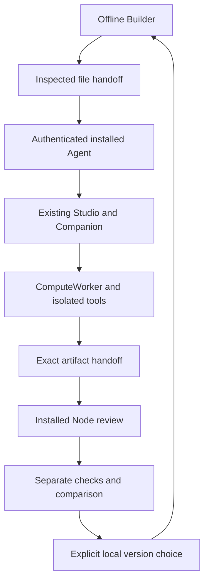

# SUCCESSOR Ω + Fleet architecture and trust boundaries

The accepted Manager Builder is pinned to `46560bd5b52592909baf0c70ee87c9b61b329169` (1.16.0). `fleet/successor/vendor/manager-provenance.json` lists exact upstream hashes and retained MIT/Apache notices. No upstream file is edited; `build.mjs` applies checked UI-only adaptations: Fleet navigation, namespaced public storage and explicit file handoff. Drift fails the build. Core mission execution, capsule validators, separate checker, comparison and USDC compiler remain upstream code.

Text equivalent: the offline Builder exports an inspected request. The installed Agent authenticates its user and authorizes one exact operation through the existing Studio/Companion/ComputeWorker. The Node reopens the same inputs and files. A separate local checker verifies returned artifacts; the user chooses the local version and exports it. No arrow grants payment or additional permissions.

## Interfaces

`inspectRequest` validates the unchanged upstream capsule and improvement plan and binds the incumbent and mission. `compileRequest` calls Manager's actual `compileComputerWork`, including its `validateComputerWork` and `checkRuntime` checks. Agent and Node use Fleet's actual `studioSpec`, `validateHandoff`, `validateBundle` and `computerVerdict`.

`SuccessorController.prepare` creates a one-minute ticket bound to the authenticated session, role, specification, input/delivery hashes, observed runtime/policy and Studio scope. `execute` requires an explicit confirmation, consumes the ticket, rechecks health/runtime and durably reserves an idempotency key before calling `controller.studio.start`. Existing Companion and ComputeWorker budgets, read-only inputs, sandbox cleanup, STOP, policy drift and cancellation remain in force. An uncertain reservation is retained and cannot replay on restart. A new attempt requires a new reviewed specification. The parent-plan commitment is inert provenance; runtime still refuses nonempty dependencies and delegation.

Authenticated installed routes: `GET /api/successor`, `GET /api/successor/runtime`; `POST /api/successor/prepare`, `/execute`, `/revoke`, `/stop`, `/result`. They retain the existing exact loopback Host/Origin checks, HttpOnly SameSite session and CSRF gate. Tickets never appear in URLs or exported project files. Local browser sessions and a trusted local OS are part of the existing trust model; a malicious same-user process or extension is outside remote attestation claims. There is no wildcard CORS, hosted-to-local call, arbitrary URL proxy or new LAN service. Restart invalidates pending tickets.

`checkReturnedWork` reopens actual bytes, independently recomputes the two supported local families and verifies the reusable method bytes. External/generated code is never executed on import. Accepted method changes create an unselected upstream-compatible candidate; rejection retains the incumbent. General custom deliverables remain in Studio with their criterion records; they do not become arbitrary imported executable capabilities. A Node receipt is a hash-bound local record, not proof of independent ownership or authenticated remote authorship.

## Stores and recovery

Portable public project data stays in the upstream capsule. Local dispatch records live in `successor-execution`; actual outputs remain in the bounded existing `work-studio` shelf. Wallet and provider material stay in their existing private stores. Large portable files use a separate sidecar with streamed SHA-256 inspection and bounded path/count/size checks. Sidecars and dispatch history are explicitly excluded from wallet recovery; export separately. Restored project data carries `authority: none` and no renewed qualification.

## Threat model

Both GitHub Pages projects share the `montrealai.github.io` origin. Namespaced browser storage avoids accidental collisions; it is not a security boundary. The hosted/offline Builder retains `connect-src 'none'`, an empty sandbox on generated previews and hash-pinned inline application code. No session token, key or private data belongs there. Local files and every imported record are untrusted, bounded and revalidated. The trusted runtime fetches allowed public input references and checks immutable hashes; the website fetches nothing.

Runtime responses come through the installed Companion's bearer-authenticated loopback connection; this is local service authentication under the OS boundary, not remote attestation. Readiness is freshly observed before dispatch. Provider invoices, actual independence and production competence remain separately unverified. Preserve existing admission and signer workflows for financial actions; Builder endpoints never invoke them.

## Current documentation checked

Official [OpenAI computer-use guidance](https://developers.openai.com/api/docs/guides/tools-computer-use) supports isolated execution, bounded runs and checking actual outcomes; tool observations do not grant authority. [OpenClaw browser documentation](https://docs.openclaw.ai/tools/browser) distinguishes dedicated managed profiles from signed-in user profiles. These current pages were inspected on 2026-10-13. Fleet keeps its evaluated OpenClaw 2026.9.5/Node 24.21.0 pins; current documentation is not a claim that a newer runtime or feature has been commissioned here.
